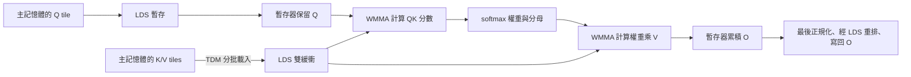

# gfx1250 BF16 Attention Forward 設計說明

本文說明截至 2026-11-08 的實作，讀者不需要先讀 FlashAttention-4（FA4）論文。
重點是：這個 kernel 算什麼、資料如何在 GPU 裡移動，以及目前保留了哪些優化。

目前這是一個針對 AMD gfx1250 的獨立 HIP kernel。它借用 FA4 的「有需要才修正
softmax 累積值」概念，再配合 gfx1250 的資料搬運與矩陣指令。
它尚未實作完整的 FA4 非同步架構，也不是原作者 CUDA kernel 的逐行移植。

## 1. 這個 kernel 要算什麼？

Attention 可以理解成「每個位置先判斷其他位置有多重要，再把它們的資訊加權合併」。
它有三個輸入：

| 輸入 | 直覺上的角色 |
|---|---|
| Q（Query） | 這個位置想找什麼 |
| K（Key） | 每個位置提供什麼線索，用來和 Q 算相似程度 |
| V（Value） | 最後真正要加權合併的內容 |

對某一列 Q，計算分成三步：

1. 與每一列 K 做內積，乘上縮放係數，得到分數。
2. 用 softmax 把分數轉成非負、總和為 1 的權重。
3. 用權重加總 V，得到這一列的輸出 O。

用矩陣寫法表示就是 `O = softmax(scale × QKᵀ) × V`。
`Kᵀ` 表示在計算上把 K 的行列交換，不表示一定要先產生一份轉置後的記憶體副本。
測試使用 `scale = 1 / sqrt(128)`；公開介面接受正且有限的 scale。

Dense attention 可以看全部 K。Causal attention 只允許第 i 列 Q 看第 j 列 K 中
`j ≤ i` 的位置，避免看到未來。這裡採用 **top-left causal**：即使 Q/K 長度不同，
仍然直接比較它們從 0 開始的位置，不會自動補上長度差。

## 2. 支援的資料與範圍

Q/K/V/O 都使用連續的 **BSHD** 排列，四個字母代表：

| 維度 | 意義 | 本次主要測試值 |
|---|---|---|
| B | Batch，一次處理幾筆序列 | 32 |
| S | Sequence length，序列有幾個位置 | 512–32768 |
| H | Head，平行處理的 attention 頭數 | 8 |
| D | 每個 head 的向量長度 | 固定 128 |

例如 B1、B4 就分別代表 batch size 1、4，與資料精度無關。
Q/O 的 shape 是 `[B, Sq, H, 128]`，K/V 是 `[B, Sk, H, 128]`，Sq 和 Sk 可以不同。

在 BSHD 中，一個位置的各個 head 相鄰；固定一個 head 往下一個序列位置走，
要跨過 `H × 128` 個元素。因此 kernel 直接使用這個 stride 讀資料，無須先把輸入
轉成 BHSD。尾端不足一個 tile 的情況也有處理。

輸入與輸出是 BF16；矩陣乘法的累加、softmax 分母及 O 的中間累積值使用 FP32。
送入第二次矩陣乘法的未正規化權重會轉成 BF16。
可選擇額外輸出 FP32 的 LSE，shape 為 `[B, H, Sq]`。LSE 是每列
`log(sum(exp(score)))`，記錄 softmax 的正規化資訊；單純產生 O 時可以不寫它。

目前不支援 GQA、每筆不同長度的 varlen、paged KV、dropout、bias、sliding window
或 backward。Q/K/V 的 head 數必須相同。完整的 pointer、對齊與 stream 契約見
[公開介面](include/fav4_bshd.h)。

## 3. 為什麼分塊計算可以省下很多記憶體？

直接照公式做，容易先產生完整的分數矩陣，再寫出 softmax 權重矩陣。
它們的大小都隨 `Sq × Sk` 成長。光是一個 head 的 32K × 32K 分數矩陣，
若以 FP32 儲存就需要 4 GiB；還沒算其他 head 與 batch。

FlashAttention 的基本做法是分塊處理：固定一小塊 Q，一次只看一小塊 K/V，
把結果累積起來，最後才寫出 O。完整的分數矩陣與權重矩陣都不必寫入 GPU 主記憶體。
這是 FlashAttention 系列的共同基礎，並非 FA4 才加入的特性。
Dense 模式仍會計算所有 Q/K 配對；當 Sq、Sk 一起加倍時，主要矩陣計算量仍約增為四倍。
分塊的主要價值是減少中間結果的儲存與搬運，不是省略 attention 配對。

本實作的主要配置每個工作群組負責 **128 列 Q**，每次讀 **128 列 K/V**。
每組由 4 個 wave 組成，每個 wave 有 32 個 lane，可把它理解成 32 個一起執行指令的執行緒。
每個 wave 處理兩份各 16 列的 Q，合計整組 128 列。

以下幾個 GPU 名詞會用到：

| 名詞 | 在這個 kernel 裡的用途 |
|---|---|
| GPU 主記憶體 | 存放完整的 Q/K/V/O，容量大，但反覆讀寫成本高 |
| LDS | 工作群組共用的片上暫存區，存放目前與下一塊 K/V |
| 暫存器（register） | 計算時最直接使用的儲存空間，保留 Q、分數片段與 O 累積值 |
| TDM | 依照描述好的尺寸與 stride，把資料非同步搬進 LDS 的硬體機制 |
| WMMA | 一次做一小塊矩陣乘加的硬體指令，本實作用 BF16 乘法、FP32 累加 |



圖中的 Q 只在**每個工作群組開始時**載入一次，之後一直保留在暫存器。
不同 Q 工作群組仍可能讀取相同 K/V；這個設計沒有宣稱整個 GPU 只讀一次 K/V。

## 4. 一個工作群組如何完成工作？

主要路徑，也就是 config 132／145，大致依序做以下事情：

1. 決定自己負責哪個 batch、head，以及哪 128 列 Q。
2. 將 Q 與第一塊 K/V 搬進 LDS，再把 Q 讀入暫存器。
3. 預先搬下一塊 K/V，同時計算目前這塊的 QK 分數。
4. 遮掉 causal 或尾端越界的分數，計算 exponential 權重與 softmax 分母。
5. 用權重乘 V，把貢獻加進暫存器裡的 O。
6. 換到下一塊 K/V，重複步驟 3–5。
7. 除以最終分母，將結果轉成 BF16，寫回 O；需要時也寫 LSE。

Dense 會走完全部 K/V。Causal 會跳過整塊都在未來的 K/V，對跨過對角線的 tile
再逐元素遮罩。無效位置的分數設成負無限大，經 exponential 後就是 0。
只把越界 K/V 補零還不夠：分數為 0 仍會產生非零權重，所以遮罩不可省略。

## 5. 優化一：有需要才調整 softmax 的基準

Softmax 要算 exponential，分數太大容易溢位。常見解法是先減掉這一列的最大分數。
因為分子、分母都乘上相同倍率，最後的加權平均不變。

分塊計算時，後面才可能出現更大的分數。傳統 online softmax 每塊更新最大值，
並把先前的 O 與分母換算到新的基準。O 有很多累積元素，反覆修正會佔用指令與暫存器頻寬。

本實作採用 FA4 的 **conditional rescaling**：容許基準暫時落後，只在差距夠大時修正。
這裡把 exponential 改寫成底數 2，使用硬體原生 `exp2`：

```text
z = score × log2(e)
w = 2^(z - base)
分母 l 累加 w
分子 u 累加 w × V
最後 O = u / l
```

`score` 已經包含 scale。這裡的 w 還沒有除以分母，所以可以大於 1。
`base` 是目前的數值基準，後續不一定等於看過的最大分數。

第一塊先找最大值作為 base。後續只有新最大值**超過 base + 8** 才更新基準。
8 是底數 2 的單位，代表 `2^8 = 256` 倍，並不是刪除小權重或把 attention 截斷。

例如 base 是 10，新最大值是 15，可以繼續用 10；若新最大值變成 20，就改用 20，
並把舊分子、舊分母都乘上 `2^(10-20)`，再加入新 tile 的貢獻。

這在精確算術下仍是同一個加權平均。不過實際使用 native exp2、FP32 累加和 BF16 權重，
浮點捨入路徑不同，因此必須驗證誤差，不能承諾與另一個 kernel 逐 bit 相同。

### 進一步省掉大部分 tile 的最大值計算

Config 132／145 還加上一個保守檢查，程式中稱為 guarded max：
先沿用舊 base 計算權重，觀察一列中各部分權重的總和。
因為每個權重都非負，只要每一部分的總和都不超過 256，
其中任何單一權重就不可能超過 256，也就不需要更新 base。

若有部分總和超過 256，才回頭找這一列的最大分數。
總和超標不代表最大值一定超標，例如許多中等大小的權重也會讓總和變大；
這時算完最大值仍可能維持舊 base。
若確實要更新，就修正舊 O／分母，並在乘 V **之前**重新計算目前 tile 的權重。
暫時的 exponential overflow 也會進入這個檢查失敗的路徑。

分支採 wave 層級的投票：有 lane 需要檢查，同一 wave 會一起進入該路徑，
但各列是否更新基準仍分別決定。這也表示資料分布會影響省下多少工作。

### 延後合併分母

同一列的分數分散在 wave 的兩個 16-lane 半部。
主要配置讓兩邊各自以 FP32 累加自己的分母，最後才交換並相加。
這樣不用每處理一塊 K/V 就跨半個 wave 合併分母。

需要修正 base 時，兩邊使用相同的新基準，各自縮放自己的分母。
guarded max 也分別檢查兩邊的部分和；它可能比較保守，但不需要先合併才能作檢查。

## 6. 優化二：讓搬資料和矩陣計算盡量重疊

### K/V 使用 LDS 雙緩衝

K 和 V 各有兩份 LDS buffer。計算目前這份時，讓 TDM 把下一塊搬到另一份。
可以想成桌上有兩個盤子：處理第一盤時先把下一盤準備好，再交替使用。

主要配置的 K 每列保留 136 個 BF16 位置，V 每列保留 144 個，實際資料都是 128 個。
額外空間是 LDS padding，用來調整讀取布局；不是改變 head dimension。
兩份 K 加兩份 V 一共佔用 **140 KiB LDS／工作群組**。
Q 在啟動時借用其中一份 K buffer，搬進暫存器後就把 LDS 空間交還給 K。

這提高資料重用，也有代價：LDS 與暫存器用量大，會限制同時能駐留多少工作群組。
tile 並非越大越好。

### 啟動時分工搬資料，主迴圈由一個 wave 發送 TDM

Config 132／145 啟動時由 4 個 wave 分別搬不同列的 Q/K/V，分攤第一批載入。
每個發送 TDM 的 wave 都要等待自己的搬運完成，再做工作群組同步。

進入主迴圈後，由 wave 0 發送下一塊 K/V 的 TDM；所有 wave 都參與矩陣計算。
這裡沒有一個專門只搬資料、永遠不計算的 producer wave。

### 在 LDS 與 WMMA 之間再做一層預取

資料搬到 LDS 之後，還要讀入暫存器才能餵給 WMMA。程式以 32 列 K/V 為單位分段：
算目前片段時，先讀下一個片段的 operand，也就是矩陣指令接下來要吃的輸入。

目前排程還把幾個階段接起來：QK 尾段先讀第一份 V；最後一段「權重乘 V」之前，
等待下一塊 K/V 就緒並同步，再預讀下一塊 K 的第一份 operand。
這讓部分讀取有機會藏在矩陣計算之後，而不是全部等到下一輪開頭才開始。

**預取不等於可以省掉同步。** TDM 完成計數與工作群組 barrier 仍然保留，
確保不會讀到未完成的資料，也不會過早覆寫其他 wave 還在讀的 LDS buffer。

### 用 IGLP 提示編譯器如何交錯指令

如果編譯器把 LDS 讀取排在一起、WMMA 又排在一起，仍可能出現「計算在等資料」的空檔。
程式透過 `sched_group_barrier` 等 IGLP 排程提示，限制部分指令的分組與順序，
引導編譯器交錯 LDS 讀取和 WMMA；建置時也啟用 expert scheduling。

這類排程提示與工作群組同步 barrier 的用途不同：前者主要影響編譯後的指令順序，
後者負責執行時的資料安全。排程提示也不保證固定的每周期行為，仍受編譯器影響。

## 7. 優化三：把資料排成硬體容易讀寫的樣子

### 用 LDS 轉置讀取供應 V

QK 與「權重乘 V」需要的矩陣方向不同。V 在主記憶體仍維持 BSHD，
進入 LDS 後用 gfx1250 的 `ds_load_tr16` 轉置讀取指令，直接組成 WMMA 所需的片段。
這避免事先在主記憶體建立完整的轉置 V 副本。

### 寫回前，先透過 LDS 重新分配 O

WMMA 產生的結果分散在各 lane 的暫存器中，適合繼續矩陣計算，但不一定適合連續寫回。
主要配置先把已正規化的 BF16 結果放進不再使用的 K buffer，再換一種 lane 分工寫出：
讓 16 個 lane 合作寫同一列，每個 lane 負責連續 8 個 BF16 元素。

完整 Q tile 使用 `global_store_async_from_lds_b128`，直接從 LDS 非同步寫到主記憶體。
每個 wave 有兩份 Q 片段，各發送一組 8 條 store 指令。
程式保留地址直到硬體確認接收，最後也等待非同步寫入完成。

Q 有尾端不足 tile 的情況時，改用帶列邊界檢查的一般向量寫入。
LSE 開關與 Q 是否完整分別產生對應版本，完整 tile 且不需要 LSE 的效能路徑可省去這些工作。

### 調整工作群組的處理順序

不同 Q tile 會讀取相同 head 的 K/V。調整工作群組順序，有機會改善快取重用與負載分配。
目前的索引重排以 8 個分組為基礎，考量 gfx1250 的 XCD（GPU 計算區塊）分布；
這是工作索引的映射，不是把工作群組硬性綁定到某個 XCD。

Dense 和 causal 使用不同順序；causal 優先安排後面的 Q tile，因為它們可以看到更多 K，
計算量比較大。短序列的 config 132 還會以 16 組 batch/head 為一組交錯 Q tiles。
這個額外重排只在 `B × H` 可被 `8 × 16` 整除時啟用，其他情況走原本映射。

### 調整暫存器配置：config 145

Config 145 在 QK 階段用空的 inline assembly 保留一小段、4 個 VGPR 的配置空間。
這些值不參與 attention 算術；目的是影響 clang 分配暫存器及安排指令的方式。

實測選用了這個版本，ATT 也觀察到與 config 133 不同的指令排程。
但目前證據**不足以宣稱已修好 WMMA register bank conflict**。
它對編譯器敏感，換版後必須重新驗證與計時。

## 8. Auto 如何選配置？

呼叫 `fav4_bshd_forward(..., config=0, ...)` 時，會依 Sq 選擇：

| Q 長度 | 配置 | 每組 Q 列數 / 每次 K/V 列數 | 用途 |
|---|---:|---:|---|
| Sq < 128 | 1 | 64 / 64 | 較小 tile，減少很短 Q 的額外工作 |
| 128 ≤ Sq ≤ 2048 | 132 | 128 / 128 | 主要優化，加上短序列的工作順序調整 |
| Sq > 2048 | 145 | 128 / 128 | 主要優化，加上 QK 暫存器配置調整 |

本文第 5–7 節的完整組合主要描述 132／145，不能假設 config 1 也有全部功能。
程式另保留 2、3、25、133 供比較，它們不會由 Auto 自動選到。
Auto 目前是簡單的固定規則，沒有根據 batch、head、Sk 或時脈動態搜尋最佳配置。

## 9. 和 FA4、CK 各是什麼關係？

| 技術或元件 | 本實作的關係 |
|---|---|
| 分塊、online softmax、不寫完整分數矩陣 | FlashAttention 系列的共同基礎 |
| Conditional rescaling | 借用 FA4 概念，使用 8 個 base-2 units 的更新門檻 |
| Guarded max、延後合併分母 | 本 repo 在目前 HIP 路徑上的具體實作與優化 |
| TDM、WMMA、LDS transpose、IGLP、非同步輸出 | 針對 gfx1250 使用的硬體機制與排程 |
| 完整 FA4 非同步 pipeline、TMEM、獨立 correction warpgroup | 尚未實作；後兩者也不是這份 HIP kernel 直接使用的 AMD 介面 |
| CK | 可選的效能比較對象；部分底層描述與索引映射參考 CK，歸屬見 NOTICE |

獨立 library `libfav4_bshd.so` 不需要 CK headers 或 CK runtime。
比較 library `libck_bshd.so` 才會編譯 CK 的 `BlockFmhaPipelineQRKSVSTdmSched`，
使用 D128、M128/N128、4-wave 配置，接收相同的原生 BSHD tensors。

`reference/ck-bshd` 是比較用的 CK 原始碼快照，不是獨立 kernel 的相依套件。
因此「不依賴 CK」說的是建置與執行相依性，不代表所有底層做法都沒有參考 CK。

## 10. 哪些改善有實測支持？

優化過程同時使用兩種證據：GPU events 的 kernel 計時，以及 ATT 指令追蹤。
ATT 像是查看部分 wave 的工作時間線，可以定位等待、計算與寫回的空檔；
最終是否變快，仍以沒有開 profiler 的同 GPU 比較為準。

2026-11-06 的 S8192 dense、config 145 ATT，以 rocprofv3 擷取、rcv-cli 分析。
取樣的 64 個 wave 沒有 `s_wait_idle`，非同步輸出 store 數量也符合預期。
仍可看到啟動搬運、迴圈／尾端 TDM 等待與最後輸出等待；分析中主要暴露成本歸屬於 WMMA 與 exp2。
這只是局部指令追蹤，不能直接推算整張 GPU 的利用率，也不能把等待比例當成可達加速比。

曾試過更小的 IGLP 分組，以及在主迴圈增加 TDM 發送 wave，正確性通過但計時較慢，
因此目前未保留。這與現在「啟動時四個 wave 分攤載入」是不同的改動。

2026-11-08 更新 CK develop 至 `2d3b6e98e4ef99cf7dccf54068f333c32a441348` 後，
在新主機的同一張 GPU 重建並比較兩邊；本輪沒有重新擷取 ATT。
測試為 BF16 BSHD、B32/H8/D128、LSE 關閉，以 HIP graph／GPU events 計 kernel 時間。
每筆 warmup=5、repeat=20，兩種起跑順序合計每邊 12 筆觀察，以平均時間計算 TFLOPS，
不剔除樣本。兩邊使用相同 compiler、ISA target 與 runtime。
TFLOPS 計算 QK 與「權重乘 V」的有效乘加運算，不把 softmax 或補齊 tile 的額外計算算進去。
因此相同長度的 causal 只計算下三角的有效配對，不能直接拿 dense 的運算量套用。

| 長序列 | Dense HIP / CK TFLOPS | HIP 領先 | Causal HIP / CK TFLOPS | HIP 領先 |
|---:|---:|---:|---:|---:|
| 8192 | 2026.16 / 1827.64 | 10.86% | 1913.82 / 1671.33 | 14.51% |
| 16384 | 2050.29 / 1839.70 | 11.45% | 1975.01 / 1736.70 | 13.72% |
| 32768 | 2059.20 / 1845.62 | 11.57% | 2009.50 / 1768.08 | 13.65% |

全 14 個 workload 的合併平均都超過 10% 領先；部分短序列在單一起跑順序仍低於 10%。
上述優化是組合後的結果，不能把總加速單獨歸功於 conditional rescaling、IGLP 或某一條指令。
完整尺寸表見 [README 的效能紀錄](README.md#目前效能狀態)，換機器或編譯器需要重測。

新版 CK 與 Auto 通過 112 項正確性比較，涵蓋非整塊尺寸、不同 Q/K 長度、causal、LSE，
以及觸發 softmax 修正與 overflow 恢復路徑的資料。每個效能尺寸另比對抽樣列的 O／LSE。
測試使用高精度參考計算檢查誤差，這部分不計時，也不表示 attention kernel 使用 FP64。

## 11. 從哪裡開始讀程式？

| 檔案 | 建議關注的部分 |
|---|---|
| [include/fav4_bshd.h](include/fav4_bshd.h) | 對外輸入、限制、配置 ID |
| [src/bshd.hip](src/bshd.hip) | Auto 選擇與 kernel 啟動參數 |
| [src/bshd_kernel.hpp](src/bshd_kernel.hpp) | 工作順序、雙緩衝迴圈、softmax、輸出階段 |
| [include/gfx1250.h](include/gfx1250.h) | TDM 描述、LDS 轉置讀取、非同步寫回 |
| [benchmarks/ck_bshd.hip](benchmarks/ck_bshd.hip) | CK qr_tdm_sched 比較配置 |
| [benchmarks/bshd.py](benchmarks/bshd.py) | 正確性誤差門檻、公平計時方式、TFLOPS 計算 |
| [tests/bshd_tdm.hip](tests/bshd_tdm.hip) | 原生 BSHD 搬運與尾端補零測試 |

閱讀 kernel 時，可以先跟著「啟動載入 → QK → softmax → 乘 V → 輸出」走一遍，
再看 `Mode`、`EpiMode`、`StartupMode` 等編譯期開關。
它們決定產生哪些指令，不是在每個 GPU 執行緒裡逐項動態選功能。

演算法背景可進一步參考 [FA4 論文](https://arxiv.org/abs/2603.05451) 與
[原作者程式](https://github.com/dao-ailab/flash-attention/tree/2ed4a1f0fc0e36a6ca7b861bfbf86ebb82c4c592)。
第三方程式歸屬與授權見 [NOTICE](NOTICE) 及 [licenses](licenses/)。
