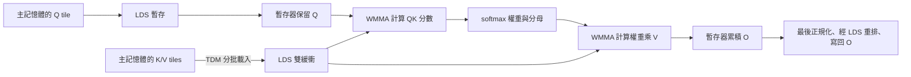

# gfx1250 BF16 Attention Forward 設計說明

本文對應本 repo 的程式版本 [`85ee282`](https://github.com/rocking5566/flash-attention-v4-rocm/commit/85ee282db96ffb1adcf3d085d295f119f2e23b22)，讀者不需要先讀 FlashAttention-4（FA4）論文。
文中的設計、支援範圍與優化均以該版本為準；效能比較另標明 CK commit。
重點是：這個 kernel 算什麼、資料如何在 GPU 裡移動，以及該版本保留了哪些優化。

這是一個針對 AMD gfx1250 的獨立 HIP kernel。它借用 FA4 的「有需要才修正
softmax 累積值」概念，再配合 gfx1250 的資料搬運與矩陣指令。
它尚未實作完整的 FA4 非同步架構，也不是原作者 CUDA kernel 的逐行移植。

## 1. 這個 kernel 要算什麼？

Attention 可以理解成「每個位置先判斷其他位置有多重要，再把它們的資訊加權合併」。
它有三個輸入：

| 輸入 | 直覺上的角色 |
|---|---|
| Q（Query） | 這個位置想找什麼 |
| K（Key） | 每個位置提供什麼線索，用來和 Q 算相似程度 |
| V（Value） | 最後真正要加權合併的內容 |

對某一列 Q，計算分成三步：

1. 與每一列 K 做內積，乘上縮放係數，得到分數。
2. 用 softmax 把分數轉成非負、總和為 1 的權重。
3. 用權重加總 V，得到這一列的輸出 O。

用矩陣寫法表示就是 `O = softmax(scale × QKᵀ) × V`。
`Kᵀ` 表示在計算上把 K 的行列交換，不表示一定要先產生一份轉置後的記憶體副本。
測試使用 `scale = 1 / sqrt(128)`；公開介面接受正且有限的 scale。

Dense attention 可以看全部 K。Causal attention 只允許第 i 列 Q 看第 j 列 K 中
`j ≤ i` 的位置，避免看到未來。這裡採用 **top-left causal**：即使 Q/K 長度不同，
仍然直接比較它們從 0 開始的位置，不會自動補上長度差。

## 2. 支援的資料與範圍

Q/K/V/O 都使用連續的 **BSHD** 排列，四個字母代表：

| 維度 | 意義 | 效能測試值 |
|---|---|---|
| B | Batch，一次處理幾筆序列 | 32 |
| S | Sequence length，序列有幾個位置 | 512–32768 |
| H | Head，平行處理的 attention 頭數 | 8 |
| D | 每個 head 的向量長度 | 固定 128 |

例如 B1、B4 就分別代表 batch size 1、4，與資料精度無關。
Q/O 的 shape 是 `[B, Sq, H, 128]`，K/V 是 `[B, Sk, H, 128]`，Sq 和 Sk 可以不同。

在 BSHD 中，一個位置的各個 head 相鄰；固定一個 head 往下一個序列位置走，
要跨過 `H × 128` 個元素。因此 kernel 直接使用這個 stride 讀資料，無須先把輸入
轉成 BHSD。尾端不足一個 tile 的情況也有處理。

輸入與輸出是 BF16；矩陣乘法的累加、softmax 分母及 O 的中間累積值使用 FP32。
送入第二次矩陣乘法的未正規化權重會轉成 BF16。
可選擇額外輸出 FP32 的 LSE，shape 為 `[B, H, Sq]`。LSE 是每列
`log(sum(exp(score)))`，記錄 softmax 的正規化資訊；單純產生 O 時可以不寫它。

該版本不支援 GQA、每筆不同長度的 varlen、paged KV、dropout、bias、sliding window
或 backward。Q/K/V 的 head 數必須相同。完整的 pointer、對齊與 stream 契約見
[公開介面](include/fav4_bshd.h)。

## 3. 為什麼分塊計算可以省下很多記憶體？

直接照公式做，容易先產生完整的分數矩陣，再寫出 softmax 權重矩陣。
它們的大小都隨 `Sq × Sk` 成長。光是一個 head 的 32K × 32K 分數矩陣，
若以 FP32 儲存就需要 4 GiB；還沒算其他 head 與 batch。

FlashAttention 的基本做法是分塊處理：固定一小塊 Q，一次只看一小塊 K/V，
把結果累積起來，最後才寫出 O。完整的分數矩陣與權重矩陣都不必寫入 GPU 主記憶體。
這是 FlashAttention 系列的共同基礎，並非 FA4 才加入的特性。
Dense 模式仍會計算所有 Q/K 配對；當 Sq、Sk 一起加倍時，主要矩陣計算量仍約增為四倍。
分塊的主要價值是減少中間結果的儲存與搬運，不是省略 attention 配對。

本實作的主要配置每個工作群組負責 **128 列 Q**，每次讀 **128 列 K/V**。
每組由 4 個 wave 組成，每個 wave 有 32 個 lane，可把它理解成 32 個一起執行指令的執行緒。
每個 wave 處理兩份各 16 列的 Q，合計整組 128 列。

以下幾個 GPU 名詞會用到：

| 名詞 | 在這個 kernel 裡的用途 |
|---|---|
| GPU 主記憶體 | 存放完整的 Q/K/V/O，容量大，但反覆讀寫成本高 |
| LDS | 工作群組共用的片上暫存區，存放正在計算與預先載入的 K/V tiles |
| 暫存器（register） | 計算時最直接使用的儲存空間，保留 Q、分數片段與 O 累積值 |
| TDM | 依照描述好的尺寸與 stride，把資料非同步搬進 LDS 的硬體機制 |
| WMMA | 一次做一小塊矩陣乘加的硬體指令，本實作用 BF16 乘法、FP32 累加 |



圖中的 Q 只在**每個工作群組開始時**載入一次，之後一直保留在暫存器。
不同 Q 工作群組仍可能讀取相同 K/V；這個設計沒有宣稱整個 GPU 只讀一次 K/V。

## 4. 一個工作群組如何完成工作？

Auto 使用的主要 M128/N128 路徑，也就是 config 150／155／156／158，大致依序做以下事情：

1. 決定自己負責哪個 batch、head，以及哪 128 列 Q。
2. 將 Q 與第一塊 K/V 搬進 LDS，再把 Q 讀入暫存器。
3. 預先搬下一塊 K/V，同時計算已載入這塊的 QK 分數。
4. 遮掉 causal 或尾端越界的分數，計算 exponential 權重與 softmax 分母。
5. 用權重乘 V，把貢獻加進暫存器裡的 O。
6. 換到下一塊 K/V，重複步驟 3–5。
7. 除以最終分母，將結果轉成 BF16，寫回 O；需要時也寫 LSE。

Dense 會走完全部 K/V。Causal 會跳過整塊都在未來的 K/V，對跨過對角線的 tile
再逐元素遮罩。無效位置的分數設成負無限大，經 exponential 後就是 0。
只把越界 K/V 補零還不夠：分數為 0 仍會產生非零權重，所以遮罩不可省略。

## 5. 優化一：有需要才調整 softmax 的基準

Softmax 要算 exponential，分數太大容易溢位。常見解法是先減掉這一列的最大分數。
因為分子、分母都乘上相同倍率，最後的加權平均不變。

分塊計算時，後面才可能出現更大的分數。傳統 online softmax 每塊更新最大值，
並把先前的 O 與分母換算到新的基準。O 有很多累積元素，反覆修正會佔用指令與暫存器頻寬。

本實作採用 FA4 的 **conditional rescaling**：容許基準暫時落後，只在差距夠大時修正。
這裡把 exponential 改寫成底數 2，使用硬體原生 `exp2`：

```text
z = score × log2(e)
w = 2^(z - base)
分母 l 累加 w
分子 u 累加 w × V
最後 O = u / l
```

`score` 已經包含 scale。這裡的 w 還沒有除以分母，所以可以大於 1。
`base` 是計算時沿用的數值基準，後續不一定等於看過的最大分數。

Config 132／150／155 先找第一塊的最大值作為 base；158 的長序列也使用這個方法。
156／157 及 158 短序列的初始選法見下文。
之後只有新最大值**超過 base + 8** 才更新基準。
8 是底數 2 的單位，代表 `2^8 = 256` 倍，並不是刪除小權重或把 attention 截斷。

例如 base 是 10，新最大值是 15，可以繼續用 10；若新最大值變成 20，就改用 20，
並把舊分子、舊分母都乘上 `2^(10-20)`，再加入新 tile 的貢獻。

這在精確算術下仍是同一個加權平均。不過實際使用 native exp2、FP32 累加和 BF16 權重，
浮點捨入路徑不同，因此必須驗證誤差，不能承諾與另一個 kernel 逐 bit 相同。

### 進一步省掉大部分 tile 的最大值計算

主要 M128/N128 配置還加上一個保守檢查，程式中稱為 guarded max：
先沿用舊 base 計算權重，觀察一列中各部分權重的總和。
因為每個權重都非負，只要每一部分的總和都不超過 256，
其中任何單一權重就不可能超過 256，也就不需要更新 base。

若有部分總和超過 256，才回頭找這一列的最大分數。
總和超標不代表最大值一定超標，例如許多中等大小的權重也會讓總和變大；
這時算完最大值仍可能維持舊 base。
若確實要更新，就修正舊 O／分母，並在乘 V **之前**重新計算該 tile 的權重。
暫時的 exponential overflow 也會進入這個檢查失敗的路徑。

分支採 wave 層級的投票：有 lane 需要檢查，同一 wave 會一起進入該路徑，
但各列是否更新基準仍分別決定。這也表示資料分布會影響省下多少工作。

### 短序列連首塊歸約也省下來

找最大值需要把一整列的分數逐步比較、合併，這個過程稱為歸約。
156／157 及 158 的 S512–2048 路徑，先選一個確實存在的分數作為起點：
每列與 K 的第 0 列配對的分數。
Top-left causal 的有效 Q 列都能看到第 0 列 K，所以 dense 與 causal 都能使用它。

把這個分數換成前面的底數 2 單位，記為 z0，初始 `base = z0 + 8`。
例如 z0 是 3，就先用 11 作為 base；這個已知分數的權重約為 `2^-8 = 1/256`。
共同縮放分子、分母不會改變精確算術下的加權平均，也不需要預先知道哪一個分數最大。
同一列分散在 wave 兩個半部，程式會交換資料，讓兩邊選到相同的第 0 欄分數。

這個起點可能低於其他分數，因此**第一塊也必須做 guarded max 檢查**。
若其他分數造成部分和超標或 exponential overflow，就找真正的最大值；需要換 base 時，
在乘 V 之前重新產生權重。更新門檻、native exp2 與數值誤差門檻都維持原設定。
這個策略省掉的是通常不必做的首塊歸約，仍會計算所有有效 attention 配對。

首塊歸約對每個 Q 工作群組只發生一次。K/V tile 越多，它在總時間中佔比越小；
實測支持將這個初始基準用在短序列；Auto 的長序列路徑保留 150 的首塊 max 方法，
固定尺寸由 158 實作，其他形狀由 150 實作。

### 延後合併分母

同一列的分數分散在 wave 的兩個 16-lane 半部。
主要配置讓兩邊各自以 FP32 累加自己的分母，最後才交換並相加。
這樣不用每處理一塊 K/V 就跨半個 wave 合併分母。

需要修正 base 時，兩邊使用相同的新基準，各自縮放自己的分母。
guarded max 也分別檢查兩邊的部分和；它可能比較保守，但不需要先合併才能作檢查。

## 6. 優化二：讓搬資料和矩陣計算盡量重疊

### K/V 使用 LDS 雙緩衝

K 和 V 各有兩份 LDS buffer。計算其中一份時，讓 TDM 把下一塊搬到另一份。
可以想成桌上有兩個盤子：處理第一盤時先把下一盤準備好，再交替使用。

主要配置的 K 每列保留 136 個 BF16 位置，V 每列保留 144 個，實際資料都是 128 個。
額外空間是 LDS padding，用來調整讀取布局；不是改變 head dimension。
兩份 K 加兩份 V 一共佔用 **140 KiB LDS／工作群組**。
Q 在啟動時借用其中一份 K buffer，搬進暫存器後就把 LDS 空間交還給 K。

這提高資料重用，也有代價：LDS 與暫存器用量大，會限制同時能駐留多少工作群組。
tile 並非越大越好。

### 啟動時分工搬資料，主迴圈由一個 wave 發送 TDM

主要 M128/N128 配置啟動時由 4 個 wave 分別搬不同列的 Q/K/V，分攤第一批載入。
每個發送 TDM 的 wave 都要等待自己的搬運完成，再做工作群組同步。

進入主迴圈後，由 wave 0 發送下一塊 K/V 的 TDM；所有 wave 都參與矩陣計算。
這裡沒有一個專門只搬資料、永遠不計算的 producer wave。

### 在 LDS 與 WMMA 之間再做一層預取

資料搬到 LDS 之後，還要讀入暫存器才能餵給 WMMA。程式以 32 列 K/V 為單位分段：
算一個片段時，先讀下一個片段的 operand，也就是矩陣指令接下來要吃的輸入。

排程還把幾個階段接起來：QK 尾段先讀第一份 V；最後一段「權重乘 V」之前，
等待下一塊 K/V 就緒並同步，再預讀下一塊 K 的第一份 operand。
這讓部分讀取有機會藏在矩陣計算之後，而不是全部等到下一輪開頭才開始。

**預取不等於可以省掉同步。** TDM 完成計數與工作群組 barrier 仍然保留，
確保不會讀到未完成的資料，也不會過早覆寫其他 wave 還在讀的 LDS buffer。

### 用 IGLP 提示編譯器如何交錯指令

如果編譯器把 LDS 讀取排在一起、WMMA 又排在一起，仍可能出現「計算在等資料」的空檔。
程式透過 `sched_group_barrier` 等 IGLP 排程提示，限制部分指令的分組與順序，
引導編譯器交錯 LDS 讀取和 WMMA；建置時也啟用 expert scheduling。
HIP 編譯另外使用 `max-ilp` 排程策略，並把 barrier signal/wait 的排程成本設為 32，
讓編譯器在安排指令時採用實測較有利的成本模型。32 不表示硬體固定等 32 cycles，
也沒有刪除或縮短執行時必要的等待。這些旗標只套用到獨立 HIP kernel；CK 旗標維持原設定。

這類排程提示與工作群組同步 barrier 的用途不同：前者主要影響編譯後的指令順序，
後者負責執行時的資料安全。排程提示也不保證固定的每周期行為，仍受編譯器影響。

### PV 依 Q 片段分組：config 150／155

把尚未正規化的權重稱為 P，乘上 V 的階段就簡稱 PV。每個 wave 負責兩份 Q 片段，
各有 16 列；每份輸出又分成八個部分，合計覆蓋 D=128。
同一段 V 的計算中，config 132／145 的寫法是先選輸出部分，再交錯處理兩份 Q。
150／155 改成先選一份 Q，連續安排它的八條 WMMA，再換另一份 Q。
這讓同一份 P operand 連續供應一組矩陣指令。156／157／158 繼承這項排程。

每組之後放入 `sched_barrier(0)`，阻止編譯器再次把兩組混排。
它只限制編譯器排程，不要求其他 wave 在執行時等到這裡。
這個改動維持相同的算術、tile 大小與 LDS 雙緩衝；必要的 TDM 等待與工作群組同步仍然保留。

### 依計算階段切換 wave 優先序

不同 wave 不一定同時走到相同階段：有的正在算矩陣，有的正在算 softmax。
150／155／156／157 在 QK 與 PV 階段將 wave priority 設為 1，softmax 階段降回 0。
158 進一步分開調整兩個矩陣階段：若 QK 與 PV 使用相同優先序，
硬體無法藉此區分它們；讓 QK 較高，就有機會改變各 wave 到達 softmax 與同步點的時機。

| 固定 S | Dense 的 QK / PV priority | Causal 的 QK / PV priority |
|---:|---:|---:|
| 512 | 1 / 1 | 2 / 1 |
| 1024、2048、4096 | 1 / 0 | 1 / 1 |
| 8192、16384、32768 | 1 / 0 | 1 / 0 |

Softmax 仍使用 0，離開主迴圈後也恢復為 0。這些選擇來自同 GPU 的分尺寸測速，
並非優先序越高就一定越快；causal S1024–4096 保留兩個矩陣階段相同的優先序。

這不會新增 wave，也不會繞過資料相依或等待；四個 wave 仍然都做 QK、softmax 與 PV。
它與 IGLP 的分工不同：IGLP 影響每個 wave 內的指令順序，priority 影響執行時各 wave 的選擇。
ATT 支持「改變階段之間的重疊」這個解釋；最終收益與限制見第 10 節。

## 7. 優化三：把資料排成硬體容易讀寫的樣子

### 用 LDS 轉置讀取供應 V

QK 與「權重乘 V」需要的矩陣方向不同。V 在主記憶體仍維持 BSHD，
進入 LDS 後用 gfx1250 的 `ds_load_tr16` 轉置讀取指令，直接組成 WMMA 所需的片段。
這避免事先在主記憶體建立完整的轉置 V 副本。

### 寫回前，先透過 LDS 重新分配 O

WMMA 產生的結果分散在各 lane 的暫存器中，適合繼續矩陣計算，但不一定適合連續寫回。
主要配置先把已正規化的 BF16 結果放進不再使用的 K buffer，再換一種 lane 分工寫出：
讓 16 個 lane 合作寫同一列，每個 lane 負責連續 8 個 BF16 元素。

完整 Q tile 使用 `global_store_async_from_lds_b128`，直接從 LDS 非同步寫到主記憶體。
每個 wave 有兩份 Q 片段，各發送一組 8 條 store 指令。
程式保留地址直到硬體確認接收，最後也等待非同步寫入完成。

Q 有尾端不足 tile 的情況時，改用帶列邊界檢查的一般向量寫入。
LSE 開關與 Q 是否完整分別產生對應版本，完整 tile 且不需要 LSE 的效能路徑可省去這些工作。

### 調整工作群組的處理順序

不同 Q tile 會讀取相同 head 的 K/V。調整工作群組順序，有機會改善快取重用與負載分配。
索引重排以 8 個分組為基礎，考量 gfx1250 的 XCD（GPU 計算區塊）分布；
這是工作索引的映射，不是把工作群組硬性綁定到某個 XCD。

Dense 和 causal 使用不同順序；causal 優先安排後面的 Q tile，因為它們可以看到更多 K，
計算量比較大。短序列的 config 132／155／156／157，以及 158 的 S512–2048，
還會以 16 組 batch/head 為一組交錯 Q tiles。
這個額外重排只在 `B × H` 可被 `8 × 16` 整除時啟用，其他情況走原本映射。

### 調整暫存器配置

Config 145／150 在 QK 階段用空的 inline assembly 保留一小段、4 個 VGPR 的配置空間。
158 只在 S4096–32768 dense 保留這項設定，causal 與短 dense 不額外保留。
這些值不參與 attention 算術；目的是影響 clang 分配暫存器及安排指令的方式。

Config 150 延續 145 的配置空間與長序列工作順序，再加入第 6 節的 PV 分組與 wave 優先序切換。
分析證據**不足以宣稱已修好 WMMA register bank conflict**。
它對編譯器敏感，換版後必須重新驗證與計時。

### 把已知尺寸交給編譯器：config 158

通用 kernel 執行時才知道 batch、head 數與序列長度，因此要在 GPU 上計算 stride、
除法與餘數，才能決定每個工作群組的資料位置。對固定尺寸，可以在編譯時先完成部分工作。

158 為 **B32/H8、Sq=Sk、S512、1024、2048、4096、8192、16384、32768**
各產生一個版本，把這些尺寸及 grid 大小當成常數。
七種尺寸各有 dense／causal、寫或不寫 LSE 的版本，合計 28 個 kernel。
Q/K/V/O pointers 與 `scale` 仍由呼叫端提供，沒有把測試資料或 scale 寫死。

Host 在啟動前檢查形狀；Auto 只在符合條件時選 158，其餘形狀使用一般配置。
若呼叫端明確指定 158 卻傳入其他形狀，會回傳參數錯誤。
這項特化簡化的是索引計算，不改變 attention 配對、tile 大小或 LDS 雙緩衝。
舊配置 157 仍保留供比較，只接受 S512／S2048，不再由 Auto 選用。

### 展開迴圈，分開處理 causal 最後一塊

每處理一塊 K/V，都有更新索引、判斷是否結束等迴圈工作。
158 的 dense 將四次迭代展開成一組，讓編譯器看見更多已知的索引與指令關係。
每次仍計算一塊 128 列 K/V，輪流使用兩份 LDS buffer；沒有同時儲存四塊資料。

固定方形尺寸的 causal 有個特性：Q 與 K 的 tile 都是 128 列，因此只有最後一塊 K
會跨過對角線。前面的完整 tiles 不需要逐元素 causal 遮罩。
將最後一塊獨立出來，編譯器就能縮短主迴圈中的判斷與部分暫存器存活時間，
最後一塊仍完整遮掉未來位置。

S1024–16384 causal 的完整 tiles 每次展開兩塊；S32768 展開四塊。
S512 causal 保留未拆尾塊、每次一塊的迴圈，因為額外展開在這個短尺寸沒有收益。
展開會增加指令碼大小與暫存器壓力，因此沒有把同一設定套到所有形狀。

## 8. Auto 如何選配置？

呼叫 `fav4_bshd_forward(..., config=0, ...)` 時，依下表順序選第一個符合條件的配置：

| 條件 | 配置 | 每組 Q 列數 / 每次 K/V 列數 | 用途 |
|---|---:|---:|---|
| B32/H8、Sq=Sk，且 S 為 512–32768 之間的 2 的整數次方 | 158 | 128 / 128 | 固定尺寸索引、迴圈展開、causal 尾塊分離、分階段優先序 |
| Sq < 128 | 1 | 64 / 64 | 較小 tile，減少很短 Q 的額外工作 |
| 其他 128 ≤ Sq ≤ 512 | 155 | 128 / 128 | 首塊 max 歸約、短序列工作順序、PV 分組與 wave 優先序 |
| 其他 513 ≤ Sq ≤ 2048 | 156 | 128 / 128 | 沿用 155 排程，以第一個有效分數設定初始基準 |
| Sq > 2048 | 150 | 128 / 128 | 長序列工作順序、QK 暫存器配置調整、PV 分組與 wave 優先序 |

150／155 分別延續 145／132 的基礎配置；156 沿用 155 的 tile 與排程。
158 的 S512–2048 使用第一個有效分數作為初始基準及短序列工作順序，
S4096–32768 使用首塊 max 及長序列工作順序。各尺寸的展開與優先序見第 6–7 節。
這些區間依代表性 workload 的實測選定，並非每個中間長度與 batch/head 組合都已量測。
本文第 5–7 節的功能以主要 M128/N128 配置為範圍，不能假設 config 1 也有全部功能。
程式另保留 2、3、25、132、133、145、157 供比較，它們不會由 Auto 自動選到。
Auto 依形狀套用固定規則，沒有根據時脈或資料內容動態搜尋配置。

## 9. 和 FA4、CK 各是什麼關係？

| 技術或元件 | 本實作的關係 |
|---|---|
| 分塊、online softmax、不寫完整分數矩陣 | FlashAttention 系列的共同基礎 |
| Conditional rescaling | 借用 FA4 概念，使用 8 個 base-2 units 的更新門檻 |
| Guarded max、首塊初始基準選擇、延後合併分母 | 該版本 HIP 路徑上的具體實作與優化 |
| TDM、WMMA、LDS transpose、IGLP、PV 分組、wave 優先序、非同步輸出 | 針對 gfx1250 使用的硬體機制與排程 |
| 完整 FA4 非同步 pipeline、TMEM、獨立 correction warpgroup | 尚未實作；後兩者也不是這份 HIP kernel 直接使用的 AMD 介面 |
| CK | 可選的效能比較對象；部分底層描述與索引映射參考 CK，歸屬見 NOTICE |

獨立 library `libfav4_bshd.so` 不需要 CK headers 或 CK runtime。
比較 library `libck_bshd.so` 才會編譯 CK 的 `BlockFmhaPipelineQRKSVSTdmSched`，
使用 D128、M128/N128、4-wave 配置，接收相同的原生 BSHD tensors。

`reference/ck-bshd` 是比較用的 CK 原始碼快照，不是獨立 kernel 的相依套件。
因此「不依賴 CK」說的是建置與執行相依性，不代表所有底層做法都沒有參考 CK。

## 10. 哪些改善有實測支持？

優化同時使用 GPU events 的 kernel 計時，以及 rocprofv3 ATT 指令追蹤、rcv-cli 分析。
ATT 像是查看部分 wave 的工作時間線，可以定位等待、計算與寫回的空檔；
最終是否變快，仍以沒有開 profiler 的同 GPU 比較為準。

### 與 ae25593 的直接比較

在同一張 gfx1250 A0 GPU0，使用相同 BF16 BSHD、B32/H8/D128 tensors，
交錯量測保存的 `ae25593` binary、整合前選定候選、`85ee282` 與 CK。
四方計時平衡各自出現的位置及前一個執行者，每邊 12 筆，每筆 warmup=5、repeat=20。
下表為 `ae25593` 平均時間除以 `85ee282` 平均時間，再減 1。

| S | Dense 相對 ae25593 提升 | Causal 相對 ae25593 提升 |
|---:|---:|---:|
| 512 | 5.79% | 3.06% |
| 1024 | 4.57% | 4.90% |
| 2048 | 4.96% | 3.09% |
| 4096 | 5.10% | 3.87% |
| 8192 | 3.67% | 5.09% |
| 16384 | 4.40% | 4.41% |
| 32768 | 4.47% | 4.98% |

所有 case 都有提升。固定尺寸迴圈、causal 尾塊、編譯器與優先序調整是組合後的收益，
不能把整體提升歸功於其中一項。28 個整合後固定尺寸 kernel 的指令位元組，
已核對與選定的候選一致；一般配置因共用程式與編譯旗標改動，也重新做正確性驗證。
這份四方資料與後面的公開兩方 benchmark 分開保存，沒有混合樣本。

### ATT：先分清楚啟動等待與重複等待

S8192 dense 的編譯器排程比較，在 GPU0 的 SE0/CU1/SIMD0 各追蹤 64 個 wave，
每次先 warmup 5 次，再擷取第 6 次 kernel；code object 與保存的 binary 相符，沒有解碼錯誤。
兩邊都有 524288 次 WMMA 與 524288 次 exp2，代表這組取樣的計算工作量相同。

採用 `max-ilp`／barrier cost 32 的版本，啟動處一個 tensor wait 的 64 筆觀察，
平均等待約 **1660.61 cycles**。但主迴圈另一個 tensor wait，在限定的中間出現次數中，
896 筆觀察平均只有 **2.38 cycles**。後者不是全部迴圈的平均；它顯示不能把啟動等待
當成每一塊 K/V 都會付出的成本。對長序列，繼續調整矩陣與 softmax 的重疊更值得測試。

### ATT：讓 QK 比 PV 更早獲得執行機會

另一組 S8192 dense 比較，在同一個開發 binary 中只切換 QK／PV priority，
softmax 都使用 0。三份 trace 各有同一個 SE/CU/SIMD 的 64 個 wave，
均為 524288 次 WMMA、524288 次 exp2，且沒有解碼錯誤。

下表為工具歸屬到所選指令的成本總和，單位為 cycles。
重複 barrier 欄只取主迴圈四個位置，合計各 4096 次，排除啟動及輸出階段。

| QK / PV priority | 重複 barrier 的 stall attribution | exp2 的 exposed attribution |
|---:|---:|---:|
| 1 / 1 | 125199 | 633718 |
| 2 / 1 | 66901 | 441920 |
| 1 / 0 | 75722 | 451856 |

兩種不相等的優先序，都減少這份取樣中暴露的 exp2 與重複同步成本；
這項差異在排除啟動後仍存在。1/0 的 WMMA stall 歸屬成本幾乎不變，
LDS 的暴露等待則有所增加，表示部分成本在階段間移動。
這些是局部 wave 的成本歸屬，並非整張 GPU 的利用率，也不能直接預測加速百分比。
工具不支援對 `s_barrier_wait` 做原始 `wait-summary` 分布，表格沒有宣稱取得這種分布。

靜態核對時，只移除 `s_setprio` 並將分支位移正規化後，三種優先序的其餘指令一致：
dense 為 6401 條，causal 為 7499 條。這項核對排除了算術或 operand 順序的改動，
有助於確認優先序的作用。
Causal trace 的 wave 數雖然同為 64，實際 WMMA／exp2 次數卻不同，
因此未把它們的原始總成本差值當成等工作量的證據。

`85ee282` 的 S8192 dense／causal 分別使用 474／482 VGPR，S32768 causal 使用 480。
這些 kernel 的編譯器回報皆為 140 KiB LDS／工作群組、2 waves/SIMD、零 scratch／spill。
這是資源與駐留上限資訊，不代表所有時間都有兩個 wave 在做有效計算。
必要的 TDM 等待、工作群組 barrier 與硬體 hazard 處理均保留；沒有新增 exponential 近似。

### 與 CK 的完整 workload 比較

效能數據對應程式版本 `85ee282`，比較 CK develop snapshot
`2d3b6e98e4ef99cf7dccf54068f333c32a441348` 的 `qr_tdm_sched`。
兩邊在同一張 gfx1250 A0 GPU0，使用相同 compiler、ISA target 與 runtime，
共用 Q/K/V/O tensors；CK source、編譯旗標及 binary 固定，每次仍與 HIP 重新計時。
HIP 額外的排程旗標見第 6 節，ATT 另行擷取，不用其時間算 TFLOPS。

公開 benchmark 使用 BF16 BSHD、B32/H8/D128、LSE 關閉、HIP graph／GPU events。
兩種起跑順序合計每邊 12 筆，每筆 warmup=5、repeat=20，不剔除樣本；
TFLOPS 由平均時間計算。計時期間沒有 profiler 或額外的 amd-smi 查詢。
TFLOPS 計算 QK 與 PV 的有效乘加，不包含 softmax 或補齊 tile 的額外工作：
dense 為 `4*B*H*D*S²`，causal 為 `4*B*H*D*S*(S+1)/2`。

| 長序列 | Dense HIP / CK TFLOPS | 領先 | Causal HIP / CK TFLOPS | 領先 |
|---:|---:|---:|---:|---:|
| 8192 | 2171.29 / 1881.41 | 15.41% | 2069.67 / 1704.08 | 21.45% |
| 16384 | 2212.69 / 1887.22 | 17.25% | 2139.36 / 1776.56 | 20.42% |
| 32768 | 2221.52 / 1895.33 | 17.21% | 2193.21 / 1805.68 | 21.46% |

14 個 workload 的合併平均皆領先 10% 以上，其中 **10 個超過 20%**，
達到「大部分 case 領先 20% 以上」的目標。所有 causal 及 S512–2048 dense 達標；
S4096 dense 為 19.74%，長 dense 為 15.41–17.25%，尚未全部越過 20%。
兩種起跑順序各有 11／14、9／14 超過 20%。接近門檻的 case 仍有波動，
例如 S1024 dense 的合併值為 20.41%，單一順序則為 22.46%／18.41%。
完整尺寸表見 [README 的效能紀錄](README.md#效能紀錄)，換機器或編譯器需重測兩邊。

### 正確性與可核對的產物

`85ee282` 通過 **1568 項數值比較**，另有 20 項參數拒絕檢查與原生 TDM 驗證：

- 1248 項一般／固定尺寸比較：CK、Auto 與一般公開配置，涵蓋尾端、不同 Q/K 長度、
  causal、LSE、首塊／後續 tile 的 softmax 修正及 overflow 恢復。
- 224 項特化比較：Auto 與 158，在七種固定尺寸分別檢查一般、較大輸入、
  不同列觸發不同修正，以及後續 tile 出現更大分數的情況。
- 96 項 runtime scale 比較：Auto 與 158，S512／1024／2048／8192、三種 scale，
  含 dense／causal 與 LSE 開關；另檢查 20 種不匹配形狀會回傳參數錯誤。

O 的 atol／rtol 均為 0.01，relative RMS 上限 0.005，LSE 最大絕對誤差上限 2e-4，
沒有放寬門檻。每個效能尺寸還比對抽樣列的 O／LSE。
高精度參考計算只用於驗證，不計入 kernel 時間；attention kernel 輸入／輸出是 BF16，
累加與 softmax 是 FP32。

原始樣本、build manifest、資源與指令核對紀錄位於未納入版控的 `results/opt60/clean/`，
建置來源與公開 benchmark 的 source hashes 已核對與 `85ee282` 一致。
編譯器及優先序 ATT 證據分別位於 `results/opt55/att/`、`results/opt59/att/`，
各自保存取樣範圍及 source／binary／decoder hashes。這些產物供追查，建置與執行不依賴它們。

## 11. 從哪裡開始讀程式？

| 檔案 | 建議關注的部分 |
|---|---|
| [include/fav4_bshd.h](include/fav4_bshd.h) | 對外輸入、限制、配置 ID |
| [src/bshd.hip](src/bshd.hip) | Auto 選擇與 kernel 啟動參數 |
| [src/bshd_kernel.hpp](src/bshd_kernel.hpp) | 工作順序、雙緩衝迴圈、softmax、輸出階段 |
| [include/gfx1250.h](include/gfx1250.h) | TDM 描述、LDS 轉置讀取、非同步寫回 |
| [benchmarks/ck_bshd.hip](benchmarks/ck_bshd.hip) | CK qr_tdm_sched 比較配置 |
| [benchmarks/bshd.py](benchmarks/bshd.py) | 正確性誤差門檻、公平計時方式、TFLOPS 計算 |
| [tests/bshd_tdm.hip](tests/bshd_tdm.hip) | 原生 BSHD 搬運與尾端補零測試 |

閱讀 kernel 時，可以先跟著「啟動載入 → QK → softmax → 乘 V → 輸出」走一遍，
再看 `Mode`、`EpiMode`、`StartupMode` 等編譯期開關。
它們決定產生哪些指令，不是在每個 GPU 執行緒裡逐項動態選功能。

演算法背景可進一步參考 [FA4 論文](https://arxiv.org/abs/2603.05451) 與
[原作者程式](https://github.com/dao-ailab/flash-attention/tree/2ed4a1f0fc0e36a6ca7b861bfbf86ebb82c4c592)。
第三方程式歸屬與授權見 [NOTICE](NOTICE) 及 [licenses](licenses/)。
